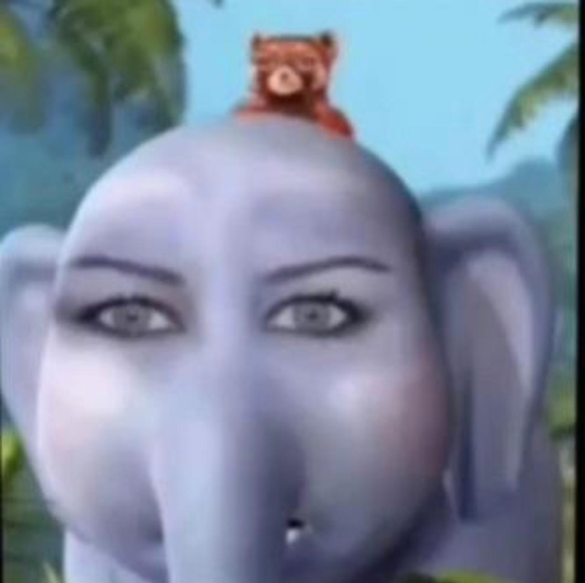

<div align="center">
  
  

  <h1>Elefantes</h1>
  <i>"Somos elefantes; nuestras palabras tienen peso"</i>
</div>

## Project Info
Welcome to our class group project! 
This repository contains the work we did for our assignment. We put a lot of effort (and coffee) into this.
The documentation is written in English to make it accessible to everyone.

## Getting Started
To run this project locally, simply clone the repository and follow these easy steps:

```bash
# Clone the repository
git clone [https://github.com/vertosofficial/Elefantes.git](https://github.com/vertosofficial/Elefantes.git)

# Enter the directory
cd Elefantes