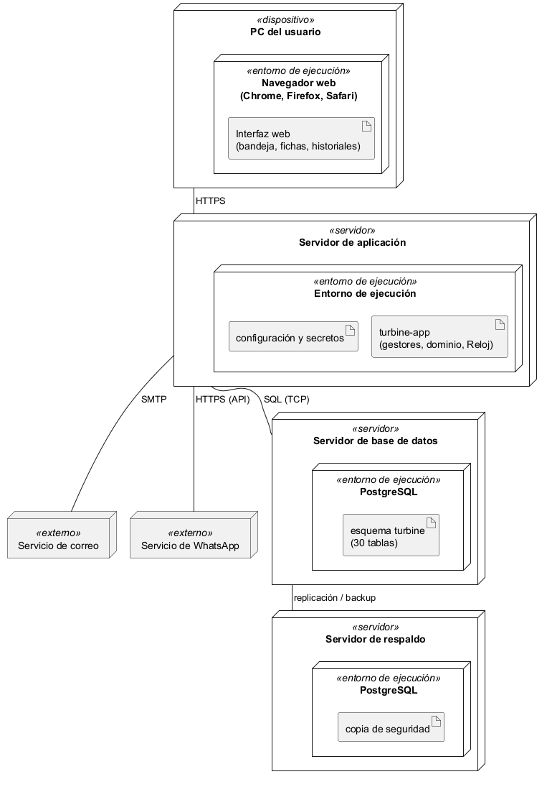

# Artefactos - Bloque 4: Seguimiento y sistema

Este apartado describe dónde se ejecuta y dónde se guarda lo que forma el bloque 4 (incidencias, tareas, notificaciones, auditoría y movimientos, reloj y gestores). Se usa un diagrama de despliegue sencillo: los equipos (nodos) y los archivos o programas que se instalan en cada uno (artefactos). Se ha mantenido el mínimo necesario.

## Qué es un artefacto

Un artefacto es un archivo o paquete concreto que se instala o se guarda en un equipo: un programa, un archivo de configuración o la base de datos. Un nodo es el equipo (físico o virtual) donde vive. El diagrama muestra qué artefacto va en qué nodo y cómo se comunican los nodos.

## Nodos

| Nodo | Qué es | Artefactos |
|---|---|---|
| PC del usuario | El ordenador del empleado de TurbineH. No instala nada: usa un navegador web (Chrome, Firefox o Safari, según PE-05). | Interfaz web: la bandeja de entrada, las fichas, los historiales y la pantalla de trabajo diario. |
| Servidor de aplicación | Equipo donde corre el sistema. | `turbine-app`: gestores (entre ellos `GestorTareas`, `Gestor_Facturas`, `GestorCobros` y `GestorMovimientos`), clases de dominio, repositorios y el `Reloj`. Configuración y secretos, separados del código. |
| Servidor de base de datos | Equipo con PostgreSQL. | Esquema `turbine`: las 30 tablas del ER, entre ellas `tarea`, `movimiento`, `notificacion` y `ajustes_sistema`. |
| Servidor de respaldo | Segundo equipo con PostgreSQL. | Copia de seguridad de la base de datos. |
| Servicio de correo | Servicio externo. | Ninguno propio: lo usa `Correo` (NOT-01, ENV-01). |
| Servicio de WhatsApp | Servicio externo. | Ninguno propio: lo usa `WhatsApp` (ENV-02). |

## Conexiones

| Entre | Protocolo | Para qué |
|---|---|---|
| PC del usuario y servidor de aplicación | HTTPS | El empleado trabaja con la interfaz web. |
| Servidor de aplicación y servidor de base de datos | SQL sobre TCP | Los repositorios guardan y leen tareas, movimientos y notificaciones. |
| Servidor de base de datos y servidor de respaldo | Replicación o copia | Mantener una copia para recuperar datos tras una caída. |
| Servidor de aplicación y servicio de correo | SMTP | Enviar las notificaciones de tipo `Correo`. |
| Servidor de aplicación y servicio de WhatsApp | HTTPS (API) | Enviar las notificaciones de tipo `WhatsApp`. |

## Dónde cae cada clase del bloque

| Clase | Artefacto | Nodo |
|---|---|---|
| `Reloj` (Singleton, Observer) | `turbine-app` | Servidor de aplicación |
| `GestorTareas`, `GestorMovimientos` y sus fábricas | `turbine-app` | Servidor de aplicación |
| `Tarea` y subclases, `Movimiento` y subclases, `Notificacion` y subclases | `turbine-app` (clases) y esquema `turbine` (datos) | Servidor de aplicación y servidor de base de datos |
| `RepositorioTareas`, `RepositorioMovimiento` | `turbine-app` | Servidor de aplicación |
| Bandeja de entrada, fichas y historiales | Interfaz web | PC del usuario |

## Decisiones

- El `Reloj` corre en el servidor de aplicación, no en los PC de los usuarios. Así hay una sola instancia (patrón Singleton) y los procesos automáticos (facturación del día 1, recordatorios, caducidad de delegaciones) se ejecutan aunque nadie tenga el navegador abierto.
- El PC del usuario solo tiene navegador. La lógica y los datos no salen del servidor, lo que cumple SEG-02: el servidor rechaza lo que el usuario no puede ver.
- Los movimientos y la auditoría se guardan solo en el servidor de base de datos. Los PDF y CSV no se guardan: se generan al descargar (ver diccionario de datos).
- La configuración y los secretos van en un artefacto aparte del código, como pide el requisito de despliegue.
- Correo y WhatsApp son servicios externos: el sistema solo se conecta a ellos, no los instala.
- El diagrama no detalla balanceadores, cachés ni más réplicas, porque no se necesitan para el alcance del proyecto.
