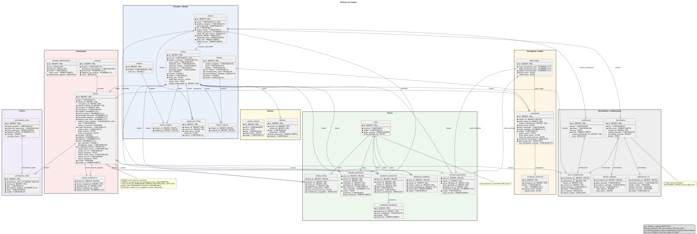

# Documentación del modelo Entidad-Relación

## 1. Introducción

Este documento explica el modelo Entidad-Relación (ER) físico del sistema de facturación de TurbineH. El modelo se ha diseñado para PostgreSQL a partir del diagrama de clases, siguiendo la guía de clases y ER acordada en la reunión del grupo. Tiene 30 tablas.

Este documento acompaña al diccionario de datos (`modelo_datos.md`), que detalla columna por columna el tipo, las restricciones y las notas de cada tabla.

## 2. Diagrama

El diagrama está también en vector en `doc/er.pdf` del repositorio, para poder ampliarlo.

## 3. Cómo se lee el diagrama

- Cada rectángulo es una tabla. Arriba va su nombre y debajo sus columnas.
- `PK` marca la clave primaria, `FK` la clave foránea (apunta a otra tabla) y `UK` un valor único. Un círculo negro (●) delante de una columna indica que no admite nulos. La leyenda está en la esquina inferior derecha del diagrama.
- Cada línea une una clave foránea con la tabla a la que apunta. Los extremos indican la cardinalidad: un lado "uno" y otro "muchos".
- Las tablas de las jerarquías de herencia (tarea, movimiento, factura) se unen con su tabla general mediante una clave que es a la vez primaria y foránea.

## 4. Cómo se pasó el diagrama de clases al ER

Reglas aplicadas:

1. Solo las clases `<<entity>>` se convierten en tablas. Gestores, repositorios y otras clases de control no tienen tabla, y los métodos no se pasan.
2. Las asociaciones de uno a muchos se convierten en una clave foránea en el lado "muchos".
3. Las asociaciones de muchos a muchos (agregación) se convierten en una tabla intermedia: `cliente_contacto` y `cliente_etiqueta`.
4. La composición se convierte en una clave foránea obligatoria. Por ejemplo, una suscripción siempre pertenece a un cliente y solo a uno.
5. La herencia se resuelve con una tabla general con los datos comunes y una tabla por cada subclase que tenga datos propios. La clave de la subclase es también clave foránea de la tabla general.
6. Las claves primarias son `BIGINT` propias. El NIF/CIF del cliente es único, pero no es la clave primaria.
7. Los estados son `VARCHAR` con restricción `CHECK`. Las fechas de negocio son `DATE` y los instantes `TIMESTAMPTZ`.
8. Los PDF y CSV no se guardan: se generan al emitir o descargar.

## 5. Tablas por grupo

### 5.1 Usuarios y clientes

| Tabla | Clase de origen | Qué guarda |
|---|---|---|
| `usuario` | Usuario (UO, AD, SAD) | Empleados de TurbineH. Una sola tabla con la columna `rol` como discriminador. |
| `asignacion_cliente` | AsignacionCliente | Historial de quién ha llevado a cada cliente. Solo un responsable vigente por cliente. |
| `cliente` | Cliente | Empresas que contratan el servicio. Nunca se borra una fila: se usa baja lógica. |
| `contacto` | Contacto | Personas de contacto, con su consentimiento de correo y WhatsApp y su idioma. |
| `cliente_contacto` | (agregación) | Relación de muchos a muchos entre cliente y contacto. |
| `etiqueta` | Etiqueta | Clasificación libre de clientes. |
| `cliente_etiqueta` | (agregación) | Relación de muchos a muchos entre cliente y etiqueta. |

### 5.2 Suscripción y tarifas

| Tabla | Clase de origen | Qué guarda |
|---|---|---|
| `tarifa_rango` | TarifaRango | Tramos de facturación con su importe mensual. Solo los edita el SAD. |
| `suscripcion` | Suscripcion | Contrato mensual de un cliente (relación 1 a 1 con `cliente`). Guarda el precio acordado, aunque el tramo cambie. |
| `excepcion_comercial` | ExcepcionComercial | Descuentos y condiciones vigentes de una suscripción. |

### 5.3 Facturación

| Tabla | Clase de origen | Qué guarda |
|---|---|---|
| `concepto` | Concepto | Catálogo de conceptos facturables. |
| `factura` | Factura | Facturas recurrentes, puntuales y rectificativas. Tiene dos estados: `estado_documento` (borrador, emitida, rectificada, anulada) y `estado_cobro` (pendiente, pagada, incobrable). |
| `factura_rectificativa` | FacturaRectificativa | Datos propios de la rectificativa: la factura original y quién la aprobó. |
| `periodo_administrativo` | PeriodoAdministrativo | Trimestres contables. |

### 5.4 Cobros

| Tabla | Clase de origen | Qué guarda |
|---|---|---|
| `movimiento_cobro` | MovimientoCobro | Cobros recibidos de una pasarela o del banco. No es la tabla `movimiento`. |
| `conciliacion_cobro` | Conciliacion | Vínculo entre un cobro y una factura. Su estado es CONCILIADO o REVERTIDO. |

### 5.5 Tareas

| Tabla | Clase de origen | Qué guarda |
|---|---|---|
| `tarea` | Tarea (abstracta) | Datos generales de toda tarea: estado, ejecutor (usuario o sistema) y fechas. |
| `delegacion_temporal` | DelegacionTemporal | Tarea de sistema. La caducidad la ejecuta el Reloj. |
| `revision_anual_tarifa` | RevisionAnual | Tarea de sistema: revisión del tramo de un cliente. |
| `solicitud_aprobacion` | SolicitudAprobacion | Tarea de usuario: operación que necesita validación de un aprobador. |
| `disputa_deuda` | DisputaDeuda | Tarea de usuario: reclamación que congela los recordatorios. |
| `incidencia_facturacion` | IncidenciaFacturacion | Tarea de usuario: incidencia con tipo y prioridad. |
| `comentario_incidencia` | ComentarioIncidencia | Comentarios de una incidencia (composición). |

### 5.6 Movimientos y notificaciones

| Tabla | Clase de origen | Qué guarda |
|---|---|---|
| `notificacion` | Notificacion (Correo, WhatsApp, NotificacionUsuario) | Todas las notificaciones en una tabla, con la columna `tipo`. |
| `movimiento` | Movimiento (abstracta) | Registro de todo lo que ocurre en el sistema. Solo se añaden filas, no se modifican. |
| `envio_comunicacion` | EnvioComunicacion | Envíos externos a un cliente, con la notificación, la factura y el contacto. |
| `registro_auditoria` | RegistroAuditoria | Bitácora de cambios, con el valor anterior y el nuevo. |
| `importacion_csv` | ImportacionCSV | Traza de cada carga masiva de datos. |

### 5.7 Sistema

| Tabla | Clase de origen | Qué guarda |
|---|---|---|
| `informe` | Informe | Informes generados. No se guarda el archivo: se genera al descargar. |
| `ajustes_sistema` | AjustesSistema (Singleton) | Parámetros globales como pares clave-valor: series de facturación, festivos y filtros guardados. |

## 6. Relaciones principales

| Desde | Hacia | Cardinalidad | Significado |
|---|---|---|---|
| `cliente` | `suscripcion` | 1 a 1 | Cada cliente tiene su suscripción (composición). |
| `cliente` | `asignacion_cliente` | 1 a N | Un cliente acumula asignaciones a lo largo del tiempo. |
| `usuario` | `asignacion_cliente` | 1 a N | Un empleado ha llevado varios clientes. |
| `cliente` | `contacto` | N a M | Mediante `cliente_contacto`. |
| `cliente` | `etiqueta` | N a M | Mediante `cliente_etiqueta`. |
| `tarifa_rango` | `suscripcion` | 1 a N | Un tramo lo usan muchas suscripciones. |
| `suscripcion` | `excepcion_comercial` | 1 a N | Una suscripción puede tener varias excepciones. |
| `cliente` | `factura` | 1 a N | Un cliente recibe muchas facturas. |
| `factura` | `factura_rectificativa` | 1 a 1 | La rectificativa extiende a la factura y apunta a la original. |
| `movimiento_cobro` | `factura` | N a M | Mediante `conciliacion_cobro`. |
| `tarea` | subclases de tarea | 1 a 1 | Cada tarea tiene una sola tabla de subclase, con la misma clave. |
| `incidencia_facturacion` | `comentario_incidencia` | 1 a N | Una incidencia tiene varios comentarios. |
| `movimiento` | `envio_comunicacion`, `registro_auditoria`, `importacion_csv` | 1 a 1 | Datos propios de cada tipo de movimiento. |
| `notificacion` | `envio_comunicacion` | 1 a N | Un envío externo guarda qué notificación envió. |
| `usuario` | `movimiento` | 1 a N | Quién realizó cada operación registrada. |
| `usuario` | `notificacion` | 1 a N | Destinatario de cada aviso interno. |

## 7. Decisiones de diseño

- **Usuario.** Una tabla con la columna `rol` en lugar de tres tablas: los tres roles comparten casi todos los datos. Las restricciones `CHECK` aseguran que cada dato solo se rellena para el rol que le corresponde.
- **Factura.** Se quitó la clase `LineaFactura`: el concepto va en la propia factura, con un solo concepto por factura.
- **Estados de la factura.** Dos ejes separados, porque una factura puede estar emitida y a la vez pendiente de cobro. Un único campo mezclaría ambos conceptos.
- **Notificación.** Una sola tabla con `tipo`, porque correo, WhatsApp y notificación de usuario comparten casi todas las columnas.
- **Movimiento.** Es la base de la auditoría no editable: solo se insertan filas. Solo `envio_comunicacion`, `registro_auditoria` e `importacion_csv` tienen tabla propia. El resto de tipos de movimiento usan solo la tabla general.
- **Cliente.** Clave propia y NIF/CIF único: si el NIF cambia o se reactiva una ficha, las referencias no se rompen.
- **Ajustes.** Tabla clave-valor para poder añadir parámetros sin cambiar el esquema.
- **Borrado.** No se borran filas de clientes, facturas ni movimientos: se marcan con un estado.

## 8. Puntos pendientes de confirmar

1. Un solo concepto por factura o una lista (en ese caso se añadiría la tabla `factura_concepto`).
2. Domicilio fiscal del cliente: campos separados (como está) o texto único (como dice la guía).
3. Estado de la factura: dos ejes (como está) o un único campo como en la guía.
4. Estado del cliente: se guarda (como dice la guía) o se deriva de la suscripción.
5. Valor `DECLARACION_INCOBRABLE` en `solicitud_aprobacion.tipo_operacion` (cerrado por la guía).
6. Dónde se guarda el resumen de los procesos automáticos (decimocuarta subclase de movimiento).
7. Nivel de visibilidad de los comentarios de incidencia.
8. Las tablas propias de las subclases de Tarea y Movimiento (propuesta de la guía, por validar).
