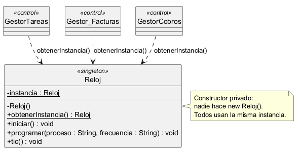
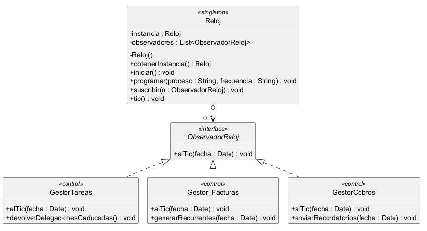
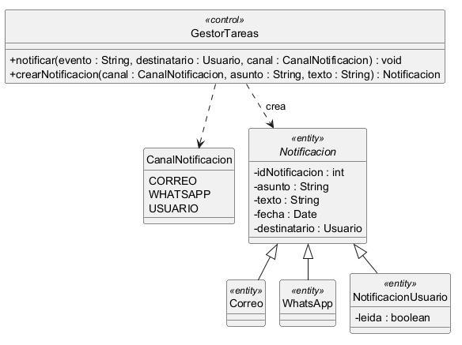
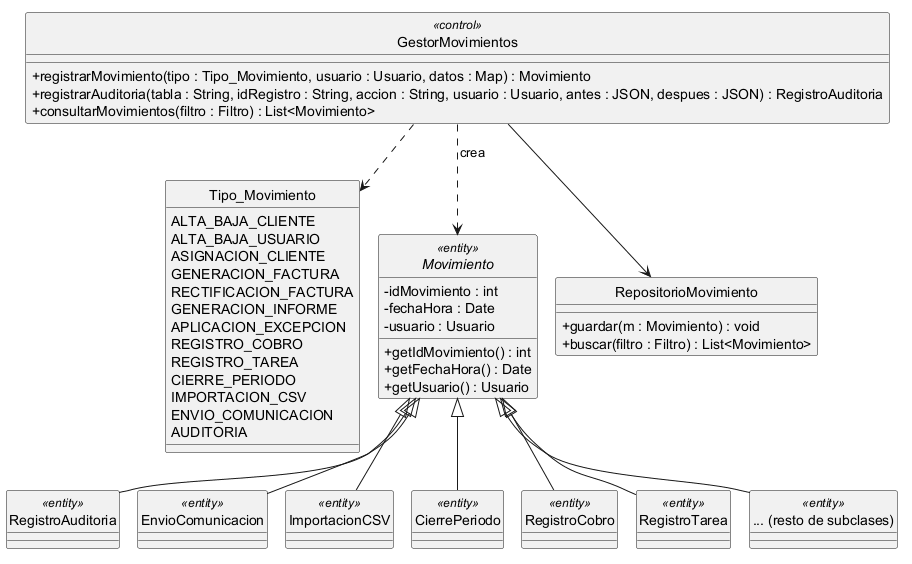
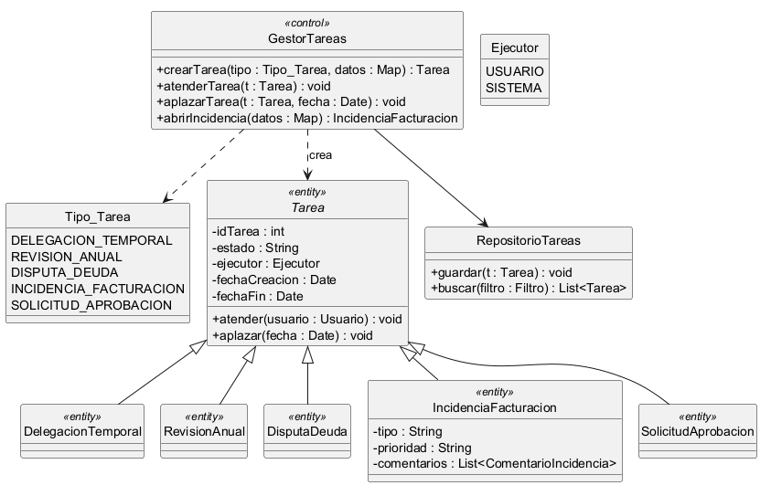

# Patrones de diseño - Bloque 4: Seguimiento y sistema

En este apartado se explican los patrones de diseño aplicados a las clases del cuarto bloque: incidencias, tareas, notificaciones, auditoría y movimientos, reloj y los gestores correspondientes. Cada patrón se describe con el mismo esquema: en qué consiste, qué clases afecta, por qué se ha usado y cómo se refleja en el sistema.

Resumen:

| Patrón | Clases del bloque | Requisitos |
|---|---|---|
| Singleton | Reloj | PRO-01, REC-01 |
| Observer | Reloj, GestorTareas, Gestor_Facturas, GestorCobros | REC-01, PRO-01 |
| Factory Method | GestorTareas, Notificación y sus 3 subtipos | NOT-01, ENV-01, ENV-02 |
| Factory Method | GestorMovimientos, Movimiento y sus subclases | AUD-01, PRO-02 |
| Factory Method | GestorTareas, Tarea y sus subclases | NOT-02, TAR-02, REC-02 |

Los patrones que afectan también a este bloque pero ya están explicados en el Bloque 2 (Repository, Specification con el Filtro, Template Method en el ciclo de vida de Tarea y Movimiento, capas Boundary-Control-Entity y guarda estática) no se repiten aquí.

## 1. Singleton: Reloj

**En qué consiste.** Garantiza que una clase tenga una única instancia y ofrece un punto de acceso global a ella.

**Clase que afecta.** `Reloj`, con atributo estático `instancia`, constructor privado y `obtenerInstancia()`.

**Por qué se ha usado.** El Reloj lanza los procesos automáticos: facturación del día 1, recordatorios, caducidad de delegaciones y recuperación de procesos tras una caída. Si hubiera dos relojes, el mismo proceso se ejecutaría dos veces y se enviarían recordatorios duplicados. Una instancia única también permite que todos los gestores compartan la misma fuente de tiempo.

**Cómo se refleja en el sistema.** Al arrancar, el sistema llama a `Reloj.obtenerInstancia().iniciar()`. Cualquier otra clase que necesite el reloj obtiene la misma instancia con `obtenerInstancia()`. El Reloj no se crea con `new` desde ningún otro sitio. Las preconfiguraciones (AjustesSistema) también son Singleton y se explican en el Bloque 2.

## 2. Observer: Reloj y gestores

**En qué consiste.** Un objeto (el sujeto) mantiene una lista de observadores y les avisa cuando ocurre algo, sin conocer qué hace cada uno con el aviso.

**Clases que afecta.**

| Rol | Clase |
|---|---|
| Sujeto | `Reloj` (`suscribir(o)`, `tic()`) |
| Observador | interfaz `ObservadorReloj` con `alTic(fecha)` |
| Observadores concretos | `GestorTareas`, `Gestor_Facturas`, `GestorCobros` |

**Por qué se ha usado.** El Reloj tiene que avisar a varios gestores de lo mismo (ha pasado un periodo de tiempo) y cada uno hace una cosa distinta. Sin el patrón, el Reloj tendría que llamar a cada gestor por su nombre y conocer sus métodos, y cada proceso nuevo obligaría a modificarlo. Con Observer, el Reloj solo conoce la interfaz `ObservadorReloj`.

**Cómo se refleja en el sistema.**

1. Al arrancar, cada gestor interesado se suscribe: `Reloj.obtenerInstancia().suscribir(gestor)`.
2. `programar(proceso, frecuencia)` registra qué procesos hay que lanzar y cada cuánto.
3. En cada `tic()`, el Reloj recorre sus observadores y llama a `alTic(fecha)`.
4. Cada gestor decide qué le toca ese día:
   - `Gestor_Facturas` genera las facturas recurrentes el día 1.
   - `GestorCobros` envía los recordatorios y avisos de impago que correspondan.
   - `GestorTareas` devuelve las delegaciones temporales caducadas.
5. Un gestor nuevo que necesite trabajar con el tiempo implementa `ObservadorReloj` y se suscribe. El Reloj no cambia.

## 3. Factory Method: Notificación

**En qué consiste.** Se delega la creación de objetos en un método de fábrica que decide qué clase concreta instanciar y devuelve el objeto como su tipo general.

**Clases que afecta.**

| Rol | Clase |
|---|---|
| Creador | `GestorTareas` (`crearNotificacion(canal, asunto, texto)`; las notificaciones no tienen gestor propio) |
| Producto | `Notificacion` (clase abstracta) |
| Productos concretos | `Correo`, `WhatsApp`, `NotificacionUsuario` |

**Por qué se ha usado.** Una notificación puede ser un correo o un WhatsApp a un cliente, o un aviso interno para la bandeja de entrada de un empleado. Quien la necesita (cobros, aprobaciones, incidencias) solo quiere avisar de un evento, no decidir qué clase crear. Sin fábrica, cada gestor repetiría un `if` por canal y quedaría acoplado a las tres clases concretas. Con ella, la decisión está en un único punto y un canal nuevo se añade como una subclase más y una línea en la fábrica.

La fábrica es parametrizada: recibe el canal como valor y devuelve el producto. Es la variante simple del patrón; la clásica, con una subclase de creador por producto, no aporta nada aquí porque los tres productos se crean con los mismos datos.

**Cómo se refleja en el sistema.**

1. Un gestor detecta un evento (pago recibido, aprobación pendiente, rebote de un correo) y llama a `GestorTareas.notificar(evento, destinatario, canal)`.
2. `notificar` llama a `crearNotificacion(canal, ...)`, que devuelve `Correo`, `WhatsApp` o `NotificacionUsuario`.
3. Si es una `NotificacionUsuario`, se guarda y aparece en la bandeja de entrada del empleado, que solo muestra este tipo. Si es `Correo` o `WhatsApp`, se envía al contacto del cliente y el envío queda registrado como movimiento.

## 4. Factory Method: Movimiento

**En qué consiste.** El mismo patrón de la sección 3: un método de fábrica elige la clase concreta y devuelve el objeto como su tipo general.

**Clases que afecta.**

| Rol | Clase |
|---|---|
| Creador | `GestorMovimientos` (`registrarMovimiento(tipo, usuario, datos)`, `registrarAuditoria(...)`) |
| Producto | `Movimiento` (clase abstracta) |
| Productos concretos | `RegistroAuditoria`, `EnvioComunicacion`, `ImportacionCSV`, `CierrePeriodo`, `RegistroCobro`, `RegistroTarea`, y el resto de subclases de movimiento |

**Por qué se ha usado.** El sistema registra más de una decena de tipos de movimiento (altas y bajas, asignaciones, facturas, cobros, cierres de periodo, auditoría...). Cada uno tiene datos propios. Si los gestores crearan los movimientos con `new` y completaran los datos ellos mismos, cada gestor conocería todas las subclases. La fábrica concentra la creación en `GestorMovimientos`, y los demás gestores solo indican el tipo y los datos.

Además refuerza la auditoría no editable (AUD-01): la fábrica solo crea y guarda movimientos nuevos. Los movimientos no tienen métodos para modificar sus datos, solo getters, y el repositorio solo ofrece `guardar` y `buscar`.

**Cómo se refleja en el sistema.**

1. Una operación relevante termina (por ejemplo, cierre de periodo) y el gestor llama a `GestorMovimientos.registrarMovimiento(CIERRE_PERIODO, usuario, datos)`.
2. La fábrica elige la subclase según el tipo, crea el movimiento con la fecha, el usuario y los datos recibidos, y lo guarda con `RepositorioMovimiento`.
3. Para la auditoría hay un método específico, `registrarAuditoria(...)`, que guarda el valor anterior y el nuevo.
4. El historial de movimientos se obtiene con `consultarMovimientos(filtro)`, que usa el patrón Specification del Bloque 2.

## 5. Factory Method: Tarea

**En qué consiste.** El mismo patrón de la sección 3, aplicado a la creación de tareas.

**Clases que afecta.**

| Rol | Clase |
|---|---|
| Creador | `GestorTareas` (`crearTarea(tipo, datos)`, `abrirIncidencia(datos)`) |
| Producto | `Tarea` (clase abstracta) |
| Productos concretos | `DelegacionTemporal`, `RevisionAnual` (ejecutor: sistema); `DisputaDeuda`, `IncidenciaFacturacion`, `SolicitudAprobacion` (ejecutor: usuario) |

**Por qué se ha usado.** Cada tipo de tarea necesita datos distintos: la incidencia lleva tipo, prioridad y comentarios; la disputa lleva motivo y fecha de revisión; la solicitud lleva el solicitante y el aprobador. Con un solo constructor habría atributos nulos o un `switch` por tipo en cada gestor. La fábrica de `GestorTareas` crea la subclase correcta y deja la lista de pendientes homogénea, porque todas son `Tarea`.

**Cómo se refleja en el sistema.**

1. Una pantalla o un proceso automático pide una tarea con `GestorTareas.crearTarea(tipo, datos)`. La incidencia tiene además `abrirIncidencia(datos)`.
2. La fábrica devuelve la subclase correspondiente, con el ejecutor (usuario o sistema) ya fijado según el tipo.
3. La tarea se guarda con `RepositorioTareas` y aparece en la bandeja o en la pantalla de trabajo diario.
4. `atenderTarea` y `aplazarTarea` funcionan igual para todas, porque trabajan con `Tarea`.

## Nota sobre las clases de este bloque

- `ComentarioIncidencia` es un atributo de `IncidenciaFacturacion` (composición), sin patrón propio.
- Las pantallas del bloque (bandeja, fichas, historiales) las construye el gestor de elementos visuales, cuyo patrón (Factory de interfaces) está en el Bloque 2.
